# Sobrevivência de pequenas empresas e risco de crédito PJ

Estudo independente com a base completa de dados abertos do CNPJ (Receita Federal, 70,5 milhões de CNPJs), da dívida ativa da União (PGFN) e do crédito bancário por segmento (SCR.data, Banco Central), de 2012 a outubro de 2026.

Autoria: Fabian Aliatti Mayer, com execução de consultas, programas e textos com apoio de IA. As perguntas, os critérios e as decisões de método são dele.

Para que serve: apoiar a gerência e a diretoria de um banco ou fintech que empresta a pequenas empresas a decidir **a quem conceder, com qual cautela e onde procurar bons clientes**, usando só dados públicos.

---

## Sumário executivo

**Termos usados.** Porte das empresas no cadastro da Receita: **MEI** (microempreendedor individual), **ME** (microempresa) e **EPP** (empresa de pequeno porte). O Banco Central agrupa MEI e ME como "Micro" e chama a EPP de "Pequena"; quando o texto usa esses dados, diz "MEIs e MEs" ou "EPPs". **Simples Nacional** é o regime de impostos simplificado das micro e pequenas empresas; "excluída do Simples" é a empresa que deixou esse regime (por dívida com a União, faturamento acima do limite ou opção própria; o cadastro não informa o motivo). **Nova dívida ativa** é imposto federal não pago e inscrito em cobrança pela PGFN (Procuradoria-Geral da Fazenda Nacional), usado aqui como sinal de mau pagador. **Modelo de referência** é um segundo modelo, mais complexo, usado só para conferir a nota: quando os dois discordam muito, a proposta vai para um analista.

### A situação em poucos números

| Indicador | Valor |
|---|---|
| MEIs que seguem abertos após 5 anos (ME 69,9%; EPP 75,7%) | **47,8%** |
| Encerramento voluntário de MEIs no 1º ano (depois, cerca de 7% ao ano) | **13,9%** |
| Empresas ativas em mai/2023 com nova dívida ativa da União ainda aberta em jun/2026 | **18,5%** |
| Nova dívida ativa: faixa A da nota × faixa E | **6,5% × 41,1%** |
| Bons clientes hoje: faixa A ou B nas duas notas e nenhuma regra de análise manual (20,0% dos MEIs, MEs e EPPs ativos) | **4,8 milhões** |
| Segmentos com bons clientes e pouco crédito (13 também com inadimplência igual ou menor que a nacional, 9 deles em São Paulo) | **34** |
| MEIs de mai/2023 que cresceram até out/2026 (608 mil) | **5,0%** |

### Cinco achados

1. **Metade dos MEIs fecha em cinco anos, e o risco não desaparece com a idade.** O encerramento voluntário é mais alto no primeiro ano (MEI 13,9%) e depois se estabiliza (MEI perto de 7% ao ano, ME perto de 5%, EPP perto de 4%). **O que fazer:** prazo e limite crescentes com a idade da empresa, sem tratar empresa com mais de três anos como livre de risco (solução 2).
2. **Entre os dados públicos analisados, os sinais mais fortes de risco são a dívida ativa da União, a saída do Simples Nacional (regime simplificado de impostos) e o histórico dos sócios.** A exclusão do Simples anda junto com a dívida: dentro da nota, depois que a dívida entra na conta, ela não acrescenta risco, e passa a valer como regra de análise manual. A concorrência local, ajustada por população e renda, não acompanha diferença no fechamento. **O que fazer:** consultar esses sinais na concessão e acompanhá-los na carteira (soluções 1 e 4).
3. **Uma nota única, com 15 variáveis e o setor dentro dela, separa bem os riscos.** A nova dívida ativa vai de 6,5% na faixa A a 41,1% na faixa E; aprovando os 80% de melhor nota, a nova dívida entre aprovados cai de 18,5% para 12,9%. No modelo de referência, um modelo por setor não foi melhor em nenhum dos 15 setores testados. **O que fazer:** adotar a nota (tabela de pontos) como filtro inicial, com uma segunda nota para o risco de fechamento e três regras de análise manual (empresa com menos de 1 ano, excluída do Simples ou com dívida em cobrança), depois de parecer do jurídico (solução 1).
4. **Há bons clientes com pouco crédito.** Em número de segmentos, a maioria são EPPs de São Paulo em serviços, transporte e indústria, com crédito 20% a 31% abaixo do esperado no padrão nacional do setor, mais bons clientes que o esperado e inadimplência menor que a nacional. Em número de clientes, pesam mais os MEIs e as MEs de transporte em São Paulo e da construção em MG. MEIs que cresceram são outro alvo a testar. **O que fazer:** oferta ativa a bons clientes desses segmentos, medida em piloto (solução 3).
5. **A época da abertura e o setor pesam.** Empresas abertas na pandemia encerraram 5% a 17% mais que o esperado em três anos. A alimentação (restaurantes, lanchonetes, bares e comida para entrega) fecha 19% mais que empresas do mesmo porte e idade, enquanto hotéis e pousadas fecham 21% menos. Na pandemia abriram cerca de 50% mais restaurantes e empresas de comida para entrega, e essas turmas encerraram 25% a 31% mais. **O que fazer:** recalibrar a nota todo ano com a extração mais recente e acompanhar a carteira por turma de abertura e setor (soluções 5 e 6).

### Decisão pedida

Aprovar dois pilotos com sorteio, antes de levar a nota para toda a carteira:

| Piloto | O que testa | Tamanho mínimo por grupo | Leitura |
|---|---|---|---|
| 1. Nota no fluxo de concessão | Se aprovar só os 80% de melhor nota reduz a inadimplência das novas concessões | de 2.324 (efeito otimista) a 10.095 (efeito conservador) concessões a MEIs e MEs; de 1.678 a 7.279 a EPPs | inadimplência 12 meses após a última concessão |
| 2. Oferta ativa a bons clientes | Se a oferta a bons clientes de segmentos pouco atendidos e a MEIs que cresceram converte mais | 3.818 empresas (para detectar conversão de 2% para 3%) | conversão em 3 meses |

### Ordem de execução

| Quando | O quê |
|---|---|
| Nov/2026 | Aprovação dos pilotos, da regra de alerta (análise manual quando nota e modelo de referência discordam muito) e parecer do jurídico sobre o uso da UF na nota |
| Dez/2026 a jan/2027 | Integração da consulta pública (CNPJ, Simples, PGFN) e da tabela de pontos ao sistema de propostas |
| Fev a jul/2027 | Concessões dos pilotos 1 e 2 (seis meses de sorteio; mais tempo se o banco tiver menos de cerca de 4.200 propostas aprováveis por mês de MEIs e MEs, ver seção 3) |
| Mai/2027 | Leitura de conversão do piloto 2; leitura intermediária do piloto 1 só para parar se houver problema |
| Ago/2028 | Leitura de inadimplência do piloto 1 (12 meses após a última concessão; muda se as concessões durarem mais) e decisão de levar a nota a toda a carteira |
| Todo ano (a partir de out/2027) | Recalibração das notas com a extração mais recente da Receita e da PGFN |

**Impacto na operação.** Cada proposta passa por três perguntas, nesta ordem, e por um ajuste de prazo no fim:

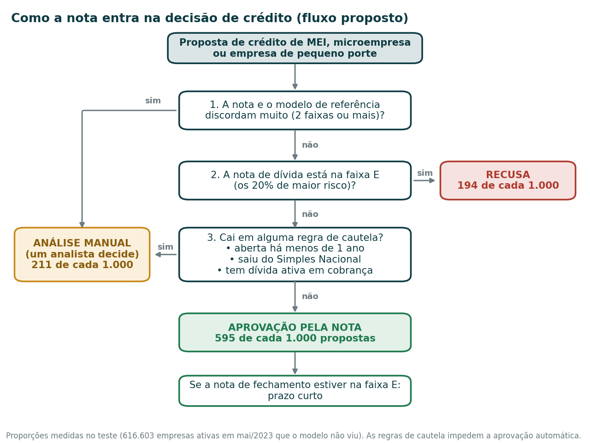

- **Resultado no teste:** o fluxo aprova 59,5% pela nota, manda 21,1% para análise manual e recusa 19,4% das propostas. A cada 1.000 propostas, são 595 aprovadas, 211 para analistas e 194 recusadas. Cerca de 1 em cada 4 propostas que não são recusadas vai para um analista: é o principal custo humano da solução.
- **Quem vai para o analista:** cerca de três quartos da fila são empresas abertas há menos de 1 ano (16,3% das propostas). Elas recebem menos nova dívida de impostos que as aprovadas pela nota (10,8% contra 13,4%), mas fecham mais (41,9% contra 33,3%): o analista cuidaria sobretudo do risco de a empresa fechar.
- **Alternativa a decidir pela diretoria de crédito:** em vez de analista, uma regra automática para empresas novas (limite baixo e prazo curto). A fila cai para 4,8% das propostas (48 a cada 1.000), mas o banco aprova sem análise um grupo em que cerca de 4 em cada 10 empresas fecham (41,9%).
- **Quanto custa recusar:** entre as 194 recusadas, 82 ficariam com nova dívida de impostos federais e 112 não. Dívida de impostos não é o mesmo que atraso com o banco; convertendo pelo fator do Banco Central (seção 1.3), seriam cerca de 32 maus pagadores e 162 bons pagadores entre MEIs e MEs. Recusar compensa se o prejuízo com um mau pagador for maior que 5 a 6 vezes o ganho com um bom cliente no mesmo prazo de contrato (5,0 para MEIs e MEs e 5,8 para EPPs). A conta compara com aprovar todos; como o banco já recusa parte dos maus hoje, o saldo real é medido no piloto.

---

## 1. Diagnóstico

### 1.1 Quanto tempo as empresas sobrevivem

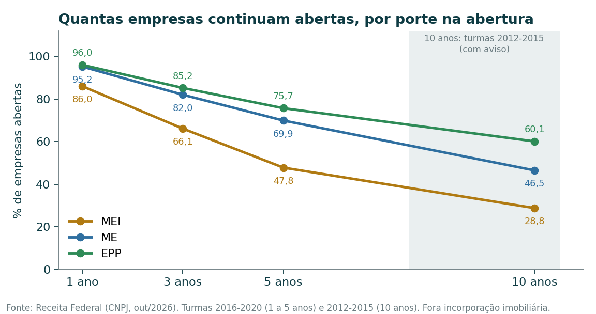

**O que os dados mostram**

- **Metade dos MEIs fecha em cinco anos.** Das empresas abertas de 2016 a 2020, seguem abertas após 1, 3 e 5 anos: MEI 86,0%, 66,1% e 47,8%; ME 95,2%, 82,0% e 69,9%; EPP 96,0%, 85,2% e 75,7%. Em 10 anos (abertas de 2012 a 2015): MEI 28,8%, ME 46,5%, EPP 60,1%.
- **O número de 10 anos tem aviso.** As empresas de 2012 a 2015 passaram pelas baixas de ofício em massa de 2015 e 2018. Contando só o encerramento voluntário, o MEI sobrevive 59,8% em 10 anos.
- **O risco é maior no primeiro ano e depois fica estável, sem chegar perto de zero.** Encerramento voluntário no 1º ano: MEI 13,9%, ME 4,8%, EPP 3,8%; do 3º ao 5º ano: MEI perto de 7%, ME perto de 5%, EPP perto de 4%.

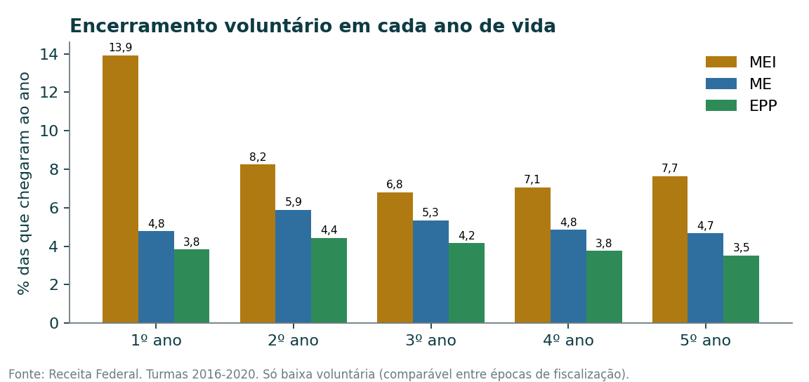

- **Setores mais frágeis: alimentação e comércio.** Entre as MEs, seguem abertas após 5 anos 58,2% na alimentação (restaurantes, lanchonetes, bares e comida para entrega) e 65,8% no comércio, contra 74% a 78% em saúde, imobiliário, indústria e construção. São também os que mais fecham deixando dívida ativa (6,9% e 5,0%). Hotéis e pousadas ficam no meio da tabela (72,5%).

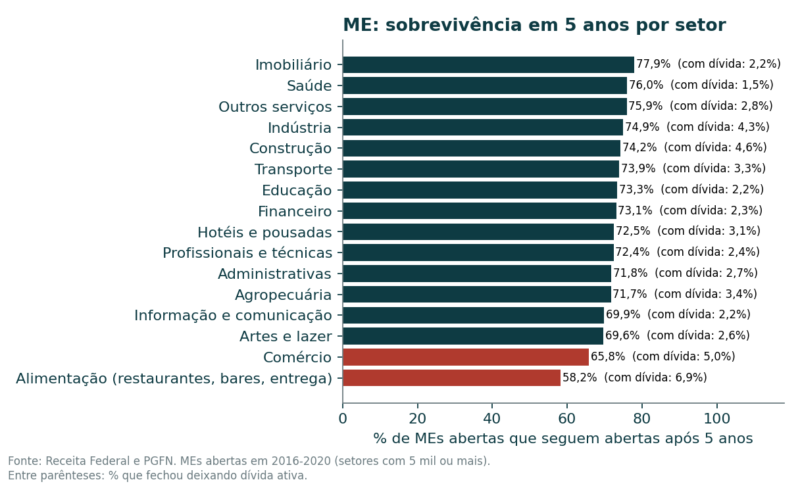

- **Por que separar hotéis e pousadas da alimentação.** A classificação de atividades da Receita (CNAE) põe no mesmo grupo, "alojamento e alimentação", hotéis e pousadas, restaurantes, lanchonetes, bares, ambulantes, comida preparada para consumo em casa (marmitas e entrega, onde se enquadram as cozinhas que vendem só por aplicativo) e bufês. Separando por atividade (empresas abertas de 2016 a 2020, de todos os portes, comparadas com as outras atividades do mesmo porte; por isso os números diferem um pouco do sumário, que compara empresas ativas em 2023 com outras do mesmo porte e da mesma idade):
    - **Hotéis e pousadas fecham menos que as outras atividades do mesmo porte:** 60,1% seguem abertos após 5 anos (dois terços são MEIs), com 9% menos fechamento.
    - **O risco está na alimentação:** de 41% a 45% seguem abertos após 5 anos em restaurantes, lanchonetes, bares, ambulantes e comida para entrega, que fecham 13% a 21% mais que as outras atividades do mesmo porte (são, na maioria, MEIs).
    - **Pandemia:** de 2019 para 2021, as aberturas cresceram 49% em restaurantes e 51% em comida para entrega (8% em hotéis e pousadas). Essas turmas encerraram 25% e 31% mais em três anos que as de 2016 a 2019 da mesma atividade (hotéis e pousadas, 5%). Todas as turmas da pandemia encerraram mais (5% a 17%, seção 1.2), mas em restaurantes e comida para entrega o aumento foi maior.
    - **Quem já existia:** em 2020, hotéis e pousadas encerraram no mesmo ritmo do resto da economia, quando nos anos anteriores encerravam cerca de 10% menos. A queda do turismo aparece, mas pequena nos encerramentos voluntários; empresas paradas podem ter ficado abertas sem operar. As de comida para entrega encerraram no mesmo ritmo do resto em 2020 e 2021 e passaram a encerrar mais a partir de 2022 (32% acima em 2024), padrão compatível com acomodação depois da onda de aberturas.

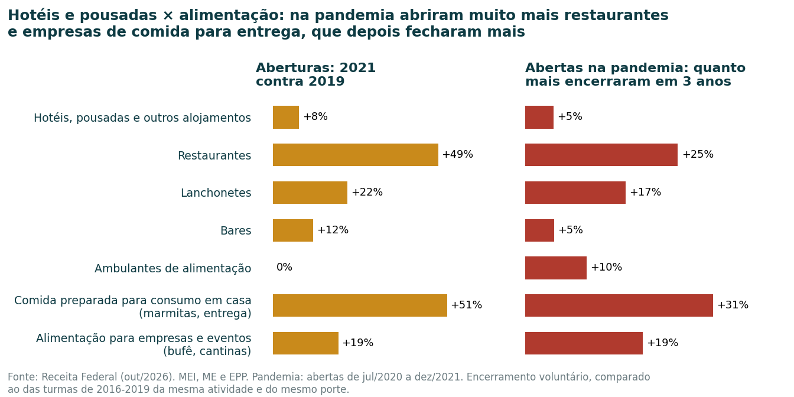

- **Dois setores fecham por motivos que não são fracasso.** Incorporação imobiliária (empresa criada para uma obra) fecha de forma planejada e fica fora do ranking de risco. MEIs da agropecuária fecham mais (55,6% em 5 anos, nas turmas de 2012 a 2020; 59,0% nas de 2016 a 2020), mais cedo e com menos dívida, padrão compatível com volta à informalidade.
- **Cidade e estado:** comparando cada lugar com o esperado para a sua mistura de porte e setor, PI, MS e SC fecham 3% a 9% menos que o Brasil; AC, AP e DF, 9% a 11% mais. No RS, cidades pequenas do interior fecham menos (Constantina 22% menos, com margem de ±9 pontos) e a Região Metropolitana de Porto Alegre fecha mais (Alvorada e Viamão 8% mais). O painel traz os 2.256 municípios com base suficiente, com a margem de cada um. Com milhares de municípios comparados, cerca de 1 em 20 passa da margem por acaso: um município isolado é indício, não prova.

**Por que importa:** o prazo do crédito disputa com a vida da empresa. Um empréstimo de 36 meses a um MEI recém-aberto atravessa o período em que um terço deles fecha.

**O que fazer:** prazo e limite crescentes com a idade; cautela adicional em restaurantes, lanchonetes, comida para entrega e comércio (hotéis e pousadas não estão entre os mais frágeis); não usar "mais de três anos" como sinônimo de risco baixo (solução 2).

### 1.2 Que características indicam mais ou menos risco

Para evitar comparar o que a empresa era com o que ela virou, os sinais foram medidos como estavam em **maio de 2023** e comparados com o que aconteceu depois, sempre contra empresas do mesmo porte e da mesma idade. Os sinais indicam associação, não causa.

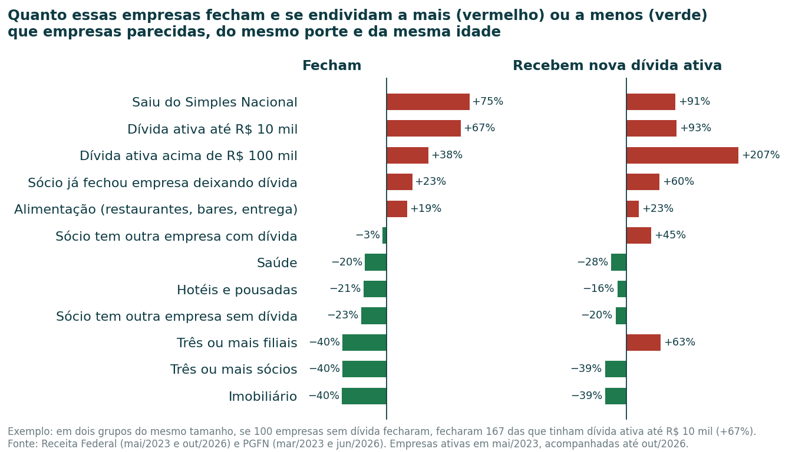

Como ler: imagine dois grupos do mesmo tamanho, com empresas do mesmo porte e da mesma idade. Num grupo, todas têm a característica (por exemplo, dívida ativa até R$ 10 mil); no outro, nenhuma tem. Se 100 empresas do segundo grupo fecharam, "+67%" quer dizer que 167 do primeiro fecharam. "−40%" quer dizer que fecharam 60.

**O que os dados mostram**

- **Dívida ativa da União é o sinal mais forte.** Empresas com dívida de até R$ 10 mil em março de 2023 fecharam 67% mais e receberam 93% mais nova dívida; com dívida acima de R$ 100 mil, 207% mais nova dívida (três vezes).
- **Saída do Simples Nacional (o regime simplificado de impostos) é sinal de alerta:** fecha 75% mais e recebe 91% mais nova dívida. Cerca de 2 em cada 3 empresas excluídas já tinham dívida ativa em mai/2023 (contra 15% no total); na nota, depois que a dívida entra na conta, a exclusão não acrescenta risco, e ela passa a valer como regra de análise manual (seção 1.3).
- **O histórico dos sócios importa (C1).** Sócio que já fechou outra empresa deixando dívida: fechamento 23% maior e 60% mais nova dívida. Sócio com outra empresa ativa e sem dívida está associado a 23% menos fechamento.
- **Estrutura acompanha menos fechamento:** três ou mais sócios (40% menos) e três ou mais filiais (40% menos). Mas empresas com filiais recebem mais nova dívida (63% mais), o que é compatível com terem mais tributos a pagar: fechar e dever são riscos diferentes.
- **Setor:** alimentação 19% acima no fechamento; hotéis e pousadas 21% abaixo; imobiliário 40% abaixo; saúde 20% abaixo.
- **Concorrência local não acompanha diferença no fechamento (C2).** Mesmo comparando cada cidade com o número de empresas esperado para a sua população e renda, cidades com o dobro do esperado fecham como as demais (razão de 0,99 a 1,02). A exceção são polos setoriais para EPPs, que fecham cerca de 10% menos. O cálculo do esperado está em `metodo/C2_empresas_esperadas.md`.
- **Época da abertura (C3):** empresas abertas a partir do 2º semestre de 2020 encerraram voluntariamente 5% (2020/2), 11% (2021/1) e 17% (2021/2) mais que o esperado em três anos. Os juros, sozinhos, não acompanham esse padrão: as empresas de 2016 abriram com Selic de 14% e fecharam no esperado.

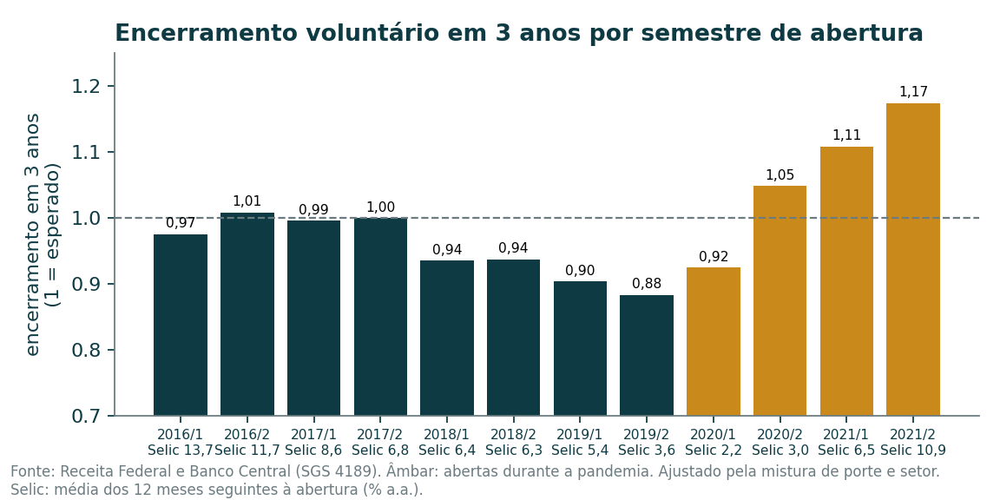

**Por que importa:** esses sinais são públicos e podem ser consultados no momento da proposta.

**O que fazer:** incluir a dívida ativa, a saída do Simples Nacional e o histórico dos sócios na análise de concessão e no acompanhamento da carteira (soluções 1 e 4).

### 1.3 Como transformar isso numa nota de risco

**O que a nota prevê.** A nota oficial estima a chance de a empresa receber **nova inscrição em dívida ativa da União que ainda esteja aberta cerca de três anos depois** (no teste: inscrição depois de 15/05/2023 ativa em jun/2026). É o sinal público mais parecido com inadimplência; como quem quitou a dívida antes de jun/2026 some do arquivo, a taxa é um piso. A segunda nota estima a chance de fechar até out/2026.

**O que os dados mostram**

- **A nota prevê bem a nova dívida ativa.** No teste com 616.603 empresas que o modelo não viu, a nova dívida foi de 6,5% na faixa A, 10,8% na B, 14,7% na C, 19,6% na D e 41,1% na E. Previsto e real ficaram a menos de 1 ponto em todas as faixas. A faixa E reúne 44,5% dos maus clientes.

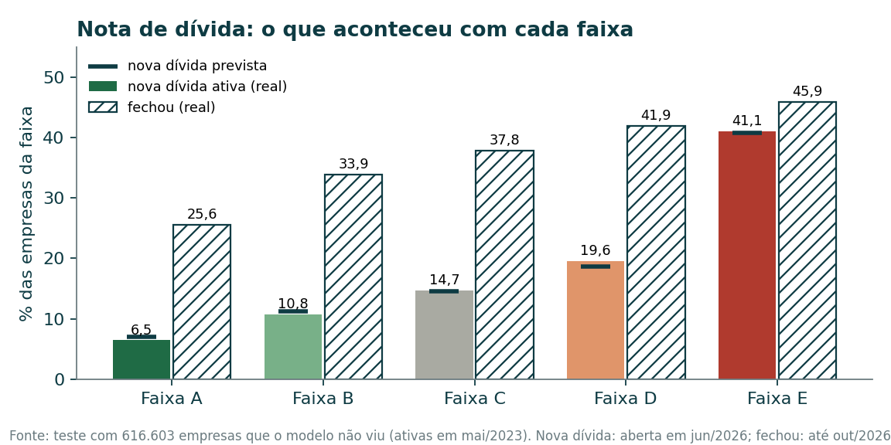

- **No modelo de referência, um método geral com o setor dentro empatou ou ganhou de um modelo por setor** em todos os 15 setores com volume suficiente. O teste foi feito com o LightGBM, não com a tabela de pontos.
- **A nota oficial é uma tabela de pontos simples.** São 15 variáveis em faixas fixas (porte e natureza, setor, UF, Simples, idade, município, capital, atividades, filiais, sócios, histórico dos sócios e perfil de dívida). Nas variáveis de risco ordenado, mais risco nunca dá mais pontos. A idade dos sócios não entra (atributo de pessoa). O capital social é declarado pela própria empresa e não é conferido pela Receita; o capital zero fica junto com "até R$ 1 mil". Essa faixa tem a maior pontuação na nota de dívida e a menor na de fechamento, e um bom cliente precisa de A ou B nas duas.
- **Três regras valem acima da nota.** Empresa aberta há menos de 1 ano, excluída do Simples ou com dívida ativa em cobrança vai para análise manual e nunca conta como bom cliente, qualquer que seja a faixa. A regra de idade se apoia no fechamento, não na dívida: empresas com menos de 1 ano recebem menos nova dívida (10,9%, contra 18,5% no total), mas fecham mais (41,8%, contra 37,0%). "Excluída do Simples" é a empresa que já optou e deixou de ser optante; o cadastro não informa o motivo (dívida, faturamento ou saída voluntária). Entre as empresas A ou B nas duas notas, as barradas por uma regra receberam nova dívida em 9,9% dos casos e fecharam em 24%, contra 7,5% e 19% das demais.
- **Ela perde pouco para um modelo mais complexo (LightGBM, 33 variáveis):** poder de separação de 0,72 contra 0,74 (AUC, em que 0,5 é sorteio e 1 é perfeito). Quando os dois divergem em duas faixas ou mais (4,7% das empresas), a proposta vai para análise manual; nesses casos o modelo complexo acertou melhor.
- **Fechar e dever são riscos diferentes; há uma nota para cada.** Mesmo na faixa A de dívida, 25,6% das empresas fecharam até out/2026. A nota de fechamento vai de 15,1% de fechamento na faixa A a 59,8% na E. Bons clientes (A ou B nas duas notas e nenhuma regra) receberam nova dívida em 7,5% dos casos.
- **Quanto o filtro rende.** Sem filtro, 18,5 de cada 100 empresas ficaram com nova dívida de impostos (os "maus"). Se o banco aprovar só as 80 de cada 100 com melhor nota, entre as aprovadas a taxa cai de 18,5% para 12,9%, com 44,4% dos maus ficando entre as recusadas. Se aprovar só as 50 melhores, cai para 9,6% e 74,1% dos maus ficam de fora, mas metade dos pedidos também é recusada. Essa conta compara com aprovar todos; como o banco já recusa parte dos maus hoje, o ganho real será menor, e o piloto tem um cenário conservador, com metade desse ganho.

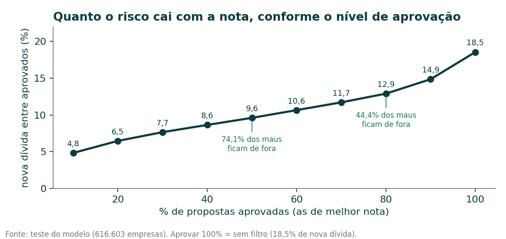

- **A nota ordena setores e estados como a inadimplência bancária real** (SCR do Banco Central; correlação de postos de 0,67 por setor e 0,63 por estado). Na média, a inadimplência bancária equivale a cerca de 0,4 vez a chance prevista de nova dívida ativa (0,40 para MEIs e MEs, 0,35 para EPPs).

**Por que importa:** a nota usa só dados públicos e dá uma primeira triagem para clientes sem histórico no banco.

**O que fazer:** usar a nota como filtro inicial, com análise manual nos casos de discordância, e testar o ganho em piloto antes de levar a toda a carteira (solução 1, piloto 1). O passo a passo da conta, com exemplo, está em `metodo/P4_nota_de_risco.md`, e o painel traz uma calculadora que reproduz a nota exatamente.

### 1.4 Onde estão os bons clientes pouco atendidos

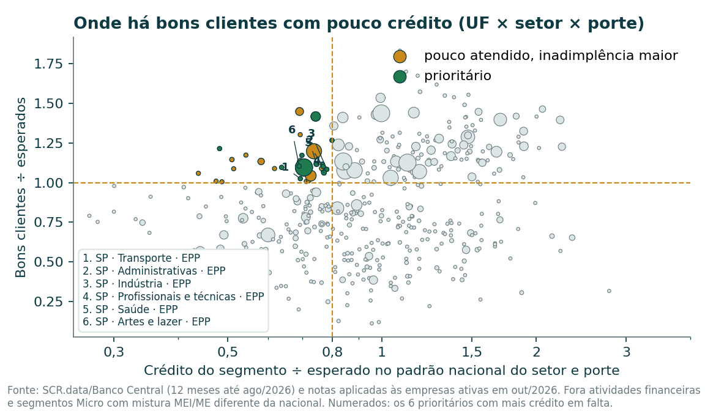

**O que os dados mostram**

- **4,8 milhões de bons clientes.** Aplicando as duas notas às empresas ativas hoje, 20,0% dos MEIs, MEs e EPPs ficam na faixa A ou B nas duas e fora das três regras de análise manual.
- **34 segmentos (UF × setor × porte) têm bons clientes e pouco crédito; em 13 a inadimplência também é igual ou menor que a nacional.** Pouco atendido: crédito abaixo de 80% do esperado no padrão nacional do setor e porte e bons clientes iguais ou acima do esperado. Prioritário: além disso, inadimplência no SCR igual ou menor que a nacional (13 segmentos, 205 mil bons clientes). Como o SCR junta MEI e ME no porte "Micro", um segmento de MEIs e MEs só entra se a sua proporção de MEIs estiver a até 10 pontos da nacional do setor; com 5 pontos, ficam 12 prioritários (sai um segmento de MEIs e MEs), e com 15 pontos, os mesmos 13.
- **Em número de segmentos, o maior grupo são as EPPs de São Paulo** (8 dos 13): transporte, serviços administrativos, indústria, serviços profissionais, saúde, educação, artes e outros serviços. O crédito fica 20% a 31% abaixo do esperado (índice de 0,690 a 0,799), com inadimplência menor que a nacional.
- **Em número de bons clientes, pesam mais dois segmentos de MEIs e MEs:** transporte em São Paulo (84% MEIs, como motoristas e entregadores; 74 mil bons clientes) e construção em MG (34 mil). Juntas, somam 53% dos bons clientes prioritários: o tamanho da oportunidade depende muito desses dois segmentos. O transporte em São Paulo passa o critério por pouco (bons clientes 9,7% contra 8,8% esperados entre MEIs e MEs; 21,3% contra 20,8% na EPP), diferença que pode estar dentro do erro da amostra de 10%.
- **Também prioritários:** MEs do imobiliário no PR e no RS e da extração em MG (nesses setores, MEI não é permitido).
- **Nos outros 21 segmentos pouco atendidos, a inadimplência é maior que a nacional** (exemplo: MEIs e MEs de energia e água no RS e no PR): ali o pouco crédito acompanha o risco.
- **Pouco crédito nem sempre é oportunidade.** RJ, AL e PE têm pouco crédito por empresa e índice de atendimento baixo, mas também menos bons clientes e mais inadimplência.
- **RS:** o estado recebe 13% mais crédito que o esperado no padrão nacional. Exceções: MEIs e MEs da construção (31% menos crédito, mas inadimplência quase duas vezes a nacional, ou seja, risco) e do imobiliário (30% menos crédito e inadimplência abaixo da nacional, ou seja, oportunidade). Entre os municípios do RS com 3 mil empresas ou mais, Serra e Litoral Norte concentram mais bons clientes por habitante (Xangri-lá, Gramado, Flores da Cunha, Garibaldi e Nova Prata, de 62 a 82 por mil habitantes).
- **MEIs que cresceram (C4).** Dos 12,2 milhões de MEIs ativos em maio de 2023, 5,0% saíram do MEI e seguiam no Simples em outubro de 2026 (608 mil; 21,6 mil já são EPP); 7,2% deles receberam nova dívida. Como continuar no Simples exige estar em dia com a União, essa taxa sai baixa em parte por construção: serve para mostrar o grupo, não como risco esperado. Os que saíram do MEI e do Simples receberam nova dívida em 78,5% dos casos (a dívida com a União é um dos motivos legais de exclusão do Simples).

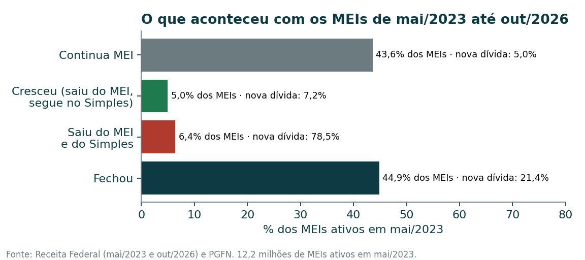

**Por que importa:** esses segmentos combinam bons clientes, bom pagamento e pouca oferta; crescer em segmentos disputados custa mais caro.

**O que fazer:** oferta ativa a bons clientes dos segmentos prioritários e a MEIs que cresceram, com a conversão medida em piloto (solução 3, piloto 2).

---

## 2. Soluções

As soluções são regras e serviços do próprio banco. A consulta aos dados públicos é do banco, mas acompanhar a carteira mês a mês exige automação ou um fornecedor (bureau), porque a PGFN publica os dados abertos a cada trimestre.

| Nº | O que fazer | Por quê | Quem faz | Custo financeiro | Custo humano |
|---|---|---|---|---|---|
| 1 | Adotar a nota de dívida como filtro inicial (faixa E abaixo do corte: recusa, salvo divergência forte) e a nota de fechamento para prazo (faixa E de fechamento: prazo curto); análise manual quando nota e modelo de referência divergem em 2 faixas ou mais e para empresa com menos de 1 ano, excluída do Simples ou com dívida em cobrança; parecer do jurídico antes | Faixa E concentra 44,5% dos maus e fica abaixo do corte (recusa); análise manual em cerca de 1 de cada 4 propostas não recusadas | Crédito, modelagem e jurídico | Baixo (tabela de pontos e consultas públicas) | Médio a alto (fila de análise manual) |
| 2 | Prazo e limite crescentes com a idade da empresa e cautela em setores frágeis | No MEI, o 1º ano tem cerca do dobro do risco dos anos seguintes; restaurantes e comida para entrega abertos na pandemia encerraram 25% a 31% mais | Política de crédito | Baixo | Baixo |
| 3 | Oferta ativa a bons clientes dos segmentos prioritários e a MEIs que cresceram | 13 segmentos com pouco crédito e inadimplência igual ou menor que a nacional (205 mil bons clientes) | Comercial e crédito | Médio (campanha) | Médio |
| 4 | Acompanhar a carteira: nova dívida ativa (dados abertos trimestrais ou consulta por CNPJ), exclusão do Simples, sócio com dívida | São os sinais mais fortes e mudam ao longo do contrato | Risco e TI | Médio (automação ou bureau) | Médio (rotina de alerta) |
| 5 | Acompanhar a carteira por turma de abertura e setor | Turmas da pandemia encerraram até 17% mais | Risco | Baixo | Baixo |
| 6 | Recalibrar as duas notas todo ano e calibrar com a inadimplência interna do banco | A relação com o SCR é por segmento, não por cliente | Modelagem | Baixo | Médio |

**Riscos a acompanhar:** a nota foi validada num único período (mai/2023 a out/2026); mudanças de regra da Receita (como ondas de inaptidão) mexem nas taxas de fechamento; a oferta ativa pode atrair clientes que o banco antes não via, por isso o sorteio; o uso da UF exige explicabilidade e cuidado contra discriminação regional.

**Se a sua empresa é...**

| Perfil | Por onde começar |
|---|---|
| Banco com carteira grande de MEIs, MEs e EPPs | Piloto 1 (nota no fluxo) e solução 4 (acompanhamento da carteira) |
| Fintech em crescimento | Solução 3 e piloto 2 (oferta a bons clientes pouco atendidos) |
| Cooperativa ou banco regional no RS | MEs do imobiliário no RS e municípios da Serra e do Litoral Norte; cautela com construção e com energia e água |

---

## 3. Pilotos

| | Piloto 1 — nota no fluxo de concessão | Piloto 2 — oferta ativa a bons clientes |
|---|---|---|
| Objetivo | Medir se a nota reduz a inadimplência das novas concessões | Medir se a oferta a bons clientes pouco atendidos converte |
| Como | Sortear propostas de MEIs, MEs e EPPs entre a política atual e a política atual mais o fluxo da nota: recusa abaixo do corte dos 80% (faixa E, salvo divergência forte), análise manual nas três regras e nas divergências fortes, aprovação pela nota no resto | Sortear bons clientes (A ou B nas duas notas e fora das três regras) dos segmentos prioritários e MEIs que cresceram, também fora das regras, entre receber oferta ou não |
| Medida principal | Taxa de contratos com atraso acima de 90 dias em 12 meses (dado interno do banco) | Conversão em 3 meses (grupo com oferta × sem oferta) |
| Medida secundária | Volume aprovado e margem | Atraso acima de 90 dias dos que contrataram, comparado com clientes atuais da mesma faixa (não entre os grupos, porque quem não recebe oferta quase não contrata) |
| Efeito esperado e base | Redução de 15% (conservador) a 30% (otimista) na inadimplência: MEIs e MEs de 5,85% para 4,96% ou 4,07%; EPPs de 7,94% para 6,73% ou 5,52% | Conversão de 2% para 3% (hipótese) |
| Antes de começar | Parecer do jurídico; integrar a consulta pública e a tabela de pontos; medir a inadimplência interna de hoje | Lista de alvos com nota atualizada; roteiro de oferta |
| Tamanho mínimo | 2.324 a 10.095 concessões por grupo (MEIs e MEs); 1.678 a 7.279 (EPPs) | 3.818 empresas por grupo |
| Prazo e o que prova | Concessões de fev a jul/2027, se o volume permitir, e leitura 12 meses após a última (ago/2028); prova o ganho da nota no banco | 3 meses para conversão; prova a viabilidade comercial |
| Decisão | Levar a nota a toda a carteira, ajustar o corte ou descartar | Ampliar a oferta, mudar o público-alvo ou encerrar |

O efeito esperado do piloto 1 não é efeito comprovado: supõe que a redução observada na nova dívida ativa se repete na inadimplência bancária, foi estimado só com o corte (sem as regras de análise manual), e a referência do SCR é estoque em valor, não contagem de contratos. O dimensionamento está no Anexo D.

**Viabilidade do piloto 1.** O sorteio divide as propostas ao meio, e o grupo com nota só concede às que passam no corte dos 80%. No cenário conservador de MEIs e MEs, esse grupo precisa de 10.095 concessões: com 1.000 propostas por mês que a política atual aprovaria, isso leva 25 meses (10.095 ÷ (0,5 × 0,8 × 1.000)); para caber nos seis meses previstos, são cerca de 4.200 por mês. Esses meses são um piso: supõem que a análise manual aprova todas as propostas que recebe; cada recusa dela alonga o piloto. Antes de começar, o banco deve estimar o seu volume mensal e ajustar a duração das concessões e a data de leitura (`resultados/p5_viabilidade.csv`), e recalcular o corte dos 80% sobre as suas próprias propostas, que não têm a mesma mistura das empresas do cadastro.

---

## 4. Metas e rotina de acompanhamento

| Meta | Dono | Hoje | Em 12 meses | Referência final | De onde vem |
|---|---|---|---|---|---|
| Propostas de MEIs, MEs e EPPs pontuadas pela nota | Gerência de crédito | 0% | 100% das propostas do piloto | 100% da carteira, se o piloto confirmar | Decisão do piloto |
| Inadimplência das concessões do piloto (grupo com nota × grupo atual) | Diretoria de crédito | medir no banco (mercado: 5,85% em MEIs e MEs e 7,94% em EPPs, SCR) | sem leitura ainda (as concessões terminam em jul/2027) | 15% a 30% menor | Cenários do piloto 1 (Anexo D) |
| Participação de bons clientes nas novas concessões | Diretoria comercial | medir no banco | definida após a leitura do piloto 2 (mai/2027) | definida após a leitura do piloto 2 | Depende do piloto 2; no mercado, 20,0% das empresas ativas são bons clientes |

**Rotina:** mensal — distribuição das propostas por faixa e casos de divergência; trimestral — alertas da carteira com o arquivo da PGFN, conversão e volume dos pilotos; anual — recalibração das notas com a extração de outubro da Receita e da PGFN.

---

## 5. Limites e pontos em aberto

- **O alvo é dívida com a União, não com bancos, e só a que segue aberta.** O arquivo da PGFN mostra as inscrições ativas na data da posição (jun/2026); quem quitou antes some, então a taxa de nova dívida é um piso. A calibragem com o SCR é por segmento, porque o SCR não identifica empresas.
- **Validação num só período.** A nota foi treinada e testada com empresas diferentes do mesmo período, não em períodos diferentes. Aplicada às empresas de hoje, mais empresas caem nas faixas A e B do que no teste (as que sobreviveram são mais velhas); a taxa de 7,5% dos bons clientes pode não valer igual hoje.
- **O cadastro público não traz faturamento, balanço nem histórico bancário.** Um banco que somar esses dados terá uma nota melhor; esta nota serve como filtro inicial e para clientes sem histórico.
- **Fechamentos dependem do calendário da Receita.** Empresas paradas só ficam inaptas cerca de dois anos depois; por isso o encerramento voluntário é usado para comparar épocas.
- **Margens.** Estados têm margens pequenas (menos de ±1 ponto na razão de fechamento na maioria; AC, AP e RR, de ±1,3 a ±1,4); municípios com 500 a 2 mil empresas, de ±5 a ±9 pontos. O painel mostra a margem de cada município.
- **O crédito por município não é público,** e o SCR não separa MEI de ME. Dentro do RS, a análise mostra onde estão os bons clientes, não quanto crédito eles já recebem.
- **Dado declarado.** O capital social é informado pela própria empresa e não é conferido; por isso entra em faixas largas, com o zero junto de "até R$ 1 mil".
- **Compliance.** A nota usa a UF (região do negócio). A idade dos sócios foi retirada por ser atributo de pessoa. Antes de usar, o jurídico precisa confirmar a explicabilidade e a ausência de discriminação.
- **Validação externa só com o Sebrae.** A comparação com a Demografia das Empresas do IBGE (C5) não foi feita.
- **As enchentes de maio de 2024 no RS não aparecem nos encerramentos voluntários** das cidades atingidas (Lajeado 2% acima da variação nacional); empresas afetadas podem ter ficado ativas sem operar.
- **Associação não é causa.** Os sinais indicam risco maior ou menor; não dizem por que a empresa fechou.

---

## Anexo A. Método e evidências técnicas

**Dados e universo.** Extrações da Receita de out/2026 (principal) e mai/2023 (retrato do passado para a nota); PGFN do 2º trimestre de 2026 (posição de jun/2026) e do 1º trimestre de 2023 (posição de mar/2023); SCR.data de jan/2024 a ago/2026; IBGE (municípios, população, PIB até 2023); Selic (BCB, série 4189). Universo: natureza jurídica empresarial (grupo 2), fora do exterior. Fechamento: baixada (menos incorporação, fusão e cisão) ou inapta. MEI na P1: opção pelo MEI em até 180 dias da abertura; na nota e na P2: MEI em mai/2023. Lista completa em `dados/FONTES.md`.

**Qualidade dos dados** (`resultados/validacao_dados.csv`): sem estabelecimentos duplicados; 1 CNPJ básico com duas matrizes (mantido, efeito nulo); 33 empresas com data de situação antes da abertura (descartadas); 299.311 baixadas no mesmo dia da abertura (mantidas com duração zero); 172.526 no exterior (excluídas); 468 devedores da PGFN sem registro no CNPJ.

**Validação externa.** Encerramento voluntário em 5 anos: MEI 35,3%, ME 22,6%, EPP 17,9% nesta base, contra 29%, 21,6% e 17% no Sebrae (2021, outra janela de turmas). Inadimplência do SCR: 5,85% em MEIs e MEs (porte "Micro") e 7,94% em EPPs (porte "Pequena") (média de 12 meses até ago/2026).

**Sobrevivência.** Medida direta por turma: cada horizonte usa só turmas em que todas as empresas completaram o prazo, no mesmo regime de fiscalização (inaptidão contínua desde 2016). Risco anual: baixas voluntárias no ano ÷ empresas que chegaram ao ano.

**Comparações justas.** Sinais e cidades comparados com o esperado para o mesmo porte e idade (P2) ou para a mesma mistura de porte e setor (P1 por cidade, C3), razão observado ÷ esperado. Margem de 95% da razão por aproximação binomial: 1,96 × raiz(soma e(1−e)) ÷ soma e.

**Retrato de mai/2023.** Os campos do cadastro atual estão contaminados pelo que aconteceu depois (exemplo: a EIRELI foi extinta em 2021 e só as fechadas continuam EIRELI). Por isso as características foram lidas na extração de mai/2023. A dívida de mai/2023 vem do arquivo PGFN de mar/2023: usar o arquivo de 2026 marcava como "sem dívida" quem quitou depois (28% dos devedores). População e PIB municipais de 2023 foram publicados depois; entram em faixas largas, com efeito desprezível.

**Nota de risco (versão 2).** Regressão logística com 15 variáveis em faixas fixas (uma coluna por faixa), convertida em pontos (600 pontos = 20 bons para 1 mau; a cada 20 pontos a chance dobra). Nas variáveis ordenadas, faixas vizinhas fora de ordem são juntadas e o modelo é refeito. Treino com 1.435.792 empresas, teste com 616.603 (sem empresa em comum). Poder de separação no teste: nova dívida AUC 0,72 (tabela) e 0,74 (LightGBM, 33 variáveis); fechamento 0,70 e 0,72. Três regras de política ficam fora da nota e valem acima dela (menos de 1 ano, exclusão do Simples, dívida em cobrança). A versão 1, com 33 variáveis, separava um pouco melhor, mas tinha faixas com sinal invertido quando lidas sozinhas; foi trocada por decisão do Fabian depois da primeira revisão (os programas da v1 estão guardados no projeto; as tabelas de resultado da v1 não foram guardadas). A conta completa, com exemplo, está em `metodo/P4_nota_de_risco.md`.

**Recálculo independente.** A nota foi refeita só com as tabelas publicadas (`p4_pontuar.py`): em 200 mil empresas do teste, diferença máxima de 0,0005 ponto e mesma faixa em mais de 99,99% (as diferenças são empresas exatamente sobre um corte). A calculadora do painel foi testada a partir dos dados brutos de 3.000 empresas (`teste_calculadora.py`): mesmas faixas nas 15 variáveis, mesma nota e mesma decisão das regras de política em 100%. Na revisão independente (camada 2), os principais números do relatório foram recalculados direto nos dados e bateram.

**Bons clientes pouco atendidos.** Notas aplicadas a uma amostra fixa de 10% das empresas ativas em out/2026 (números multiplicados por 10). Bom cliente: A ou B nas duas notas e nenhuma regra de política. Índice de atendimento = carteira ativa do SCR do segmento ÷ carteira esperada para o seu número de empresas no padrão nacional do setor e porte. Bons esperados pela mistura de MEIs e MEs. Pouco atendido: índice abaixo de 0,8, bons iguais ou acima do esperado, 2 mil empresas ou mais e, entre MEIs e MEs, proporção de MEIs a até 10 pontos da nacional do setor; prioritário: também com inadimplência igual ou menor que a nacional. Atividades financeiras ficam fora (o SCR inclui crédito entre empresas do próprio setor). Tentou-se separar o crédito de MEI e de ME entre as UFs por regressão, mas os coeficientes saíram instáveis. Sensibilidade da tolerância de 10 pontos em `resultados/p3_sensibilidade_mei.csv`.

**Histórico de revisões.** Fechamento em 10 anos refeito por turma (pedido do Fabian); agropecuária e construção testadas como hipóteses; esperado do C2 publicado com fórmula e exemplo; retrato de mai/2023 para eliminar campos atuais; dívida de mar/2023 para eliminar vazamento; revisões independentes em duas camadas (leitura de gestão e recálculo técnico), em três rodadas. Na 1ª: tabela de pontos refeita com ordem garantida e sem idade dos sócios, alvo descrito com a janela real, pilotos com cenário conservador e tamanho em concessões, calendário e metas refeitos, mistura MEI/ME tratada na P3, margens nos municípios, linguagem causal retirada. Na 2ª: regras de política fora da nota (menos de 1 ano, exclusão do Simples, dívida em cobrança), capital zero junto de "até R$ 1 mil", ordem garantida também na dívida previdenciária, teste por setor identificado como do modelo de referência, sensibilidade da mistura MEI/ME, viabilidade do piloto e calibragem com o SCR refeita. Na 3ª: fluxo de decisão medido (recusa, análise manual e aprovação), regras incluídas nos pilotos e viabilidade calculada sobre as propostas que passam no corte.

## Anexo B. Dicionário

| Termo | Significado |
|---|---|
| MEI | Microempreendedor individual |
| ME / EPP | Microempresa / empresa de pequeno porte (porte do cadastro da Receita) |
| Dívida ativa da União | Débito com a União inscrito pela PGFN (Procuradoria-Geral da Fazenda Nacional) |
| SCR | Sistema de Informações de Crédito do Banco Central (SCR.data: dados agregados por segmento) |
| Inapta | Situação de empresa que deixou de entregar declarações; conta como fechada |
| Baixa voluntária | Encerramento pedido pela própria empresa |
| Faixa A–E | Quintos da nota de risco (A = 20% melhores) |
| Bom cliente | Faixa A ou B nas duas notas (dívida e fechamento) e nenhuma regra de política (menos de 1 ano, excluída do Simples, dívida em cobrança) |
| AUC | Poder de separação do modelo (0,5 = sorteio; 1 = perfeito) |
| Índice de atendimento | Crédito do segmento ÷ crédito esperado no padrão nacional do setor e porte |
| Saturação (C2) | Empresas ativas do setor na cidade ÷ esperadas para a população e a renda da cidade |
| Turma | Empresas abertas no mesmo ano (ou semestre) |

## Anexo C. Arquivos

| Arquivo | Conteúdo |
|---|---|
| `index.html` | Painel com filtros, municípios e calculadora de nota |
| `metodo/P4_nota_de_risco.md` | Como a nota foi feita e como refazer a conta |
| `metodo/C2_empresas_esperadas.md` | Como foi calculado o número esperado de empresas por cidade |
| `resultados/*.csv` | Tabelas de todos os números do relatório |
| `scripts/` | Programas, na ordem de `rodar_tudo.py` |
| `DIARIO_DECISOES.md` | Decisões e revisões, com data |

## Anexo D. Dimensionamento dos pilotos

Casos por grupo para comparar duas proporções (80% de poder, 5% de alarme falso) = 7,84 × [p0(1−p0) + p1(1−p1)] ÷ (p0 − p1)² (`resultados/p5_pilotos.csv`).

| Piloto | Porte | Cenário | Hoje (p0) | Esperado (p1) | Por grupo |
|---|---|---|---|---|---|
| 1 | MEI e ME | otimista (−30%) | 5,85% | 4,07% | 2.324 |
| 1 | MEI e ME | conservador (−15%) | 5,85% | 4,96% | 10.095 |
| 1 | EPP | otimista (−30%) | 7,94% | 5,52% | 1.678 |
| 1 | EPP | conservador (−15%) | 7,94% | 6,73% | 7.279 |
| 2 (conversão) | todos | — | 2,0% | 3,0% | 3.818 |

- p0: inadimplência do SCR (carteira inadimplida ÷ carteira ativa, em valor, média de 12 meses até ago/2026). No piloto, substituir pela taxa de contratos com atraso acima de 90 dias do banco.
- Otimista: redução da nova dívida entre os 80% aprovados contra aprovar todos (de 18,5% para 12,9%, 30%). Conservador: metade disso, porque a política atual já recusa parte dos maus.
- O tamanho é em concessões (a inadimplência só existe para quem contratou). Meses necessários conforme o volume mensal do banco (grupo com nota concede em 80% das propostas): `resultados/p5_viabilidade.csv`. Desenho: sorteio de propostas no mesmo período e nos mesmos canais (melhor que alternar semanas ou regiões).
